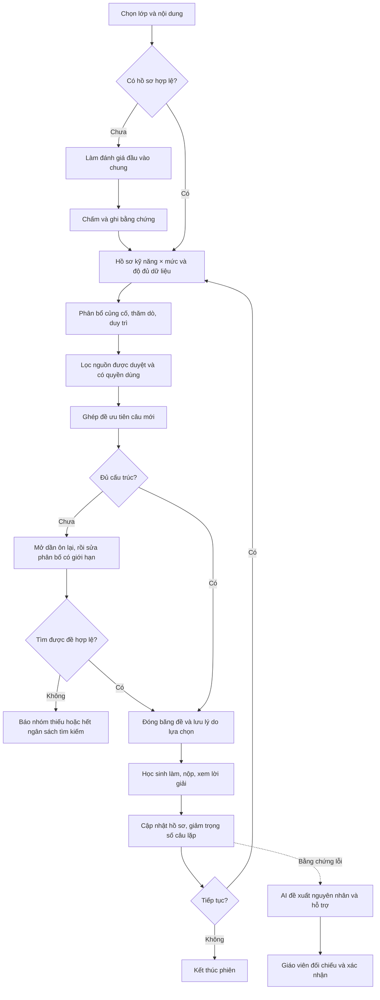

# Cá nhân hóa luyện tập xác suất lớp 9 — bản cải tiến V2

Ngày kiểm tra: 24/09/2026. Mã thuật toán mới: `aptga-recovery-v2`.

## 1. Đóng góp nên trình bày trong khóa luận

**Đề xuất một cơ chế lựa chọn bài luyện theo hồ sơ kỹ năng × mức nhận thức, có xét độ đủ của bằng chứng, lịch sử tiếp xúc câu hỏi và khả năng đáp ứng của ngân hàng; mỗi đề lưu được căn cứ lựa chọn và mức điều chỉnh.**

Đây là đóng góp thiết kế và triển khai trong phạm vi đề tài. Chưa có cơ sở để khẳng định thuật toán mới trên thế giới, tối ưu toàn cục hoặc làm tăng kết quả học tập khi chưa thực nghiệm. Việc gọi Gemini để giải thích lỗi không tự nó tạo ra tính mới.

Ba câu hỏi nghiên cứu có thể kiểm chứng:

1. Cơ chế phục hồi có tăng tỉ lệ sinh đề hợp lệ khi ngân hàng hạn chế không?
2. Cá nhân hóa có cải thiện kết quả trên **câu mới** cùng kiến thức so với chọn đề theo cấu trúc nền không?
3. Báo cáo gắn bằng chứng có giúp giáo viên xác định hỗ trợ nhanh, đúng và dễ hơn không?

## 2. Các điểm vướng đã xử lý

| Trước | Sau |
|---|---|
| Câu đã gặp trong 3 lượt hoặc 5 ngày bị loại cứng | Mở dần nguồn ôn lại khi không ghép đủ đề |
| Chỉ tiêu ba chiều phải khớp tuyệt đối | Thử cấu trúc chuẩn trước, sau đó sửa phân bố tối đa hai bước |
| Câu phải có mã ID6 hoàn chỉnh mới được luyện | Nhãn kiến thức giáo viên xác nhận là căn cứ; ID6 không bắt buộc |
| Phân loại theo mã nguồn khó hiểu | Giao diện dùng dạng kiến thức, mức nhận thức, hình thức trả lời |
| Kết quả làm lại có thể tăng mạnh ước lượng | Giảm trọng số bằng chứng theo số lần đã làm cùng nội dung |
| Chưa thấy rõ vì sao đề được chọn | Hiện số câu mới, ôn lại, vị trí điều chỉnh và bảng mục tiêu/thực tế |
| Các thẻ báo cáo thiếu nền do biến CSS chưa khai báo | Bổ sung biến màu, độ tương phản, khoảng cách và bố cục màn hình nhỏ |

Không xóa các cột ID6 và mã nguồn cũ trong cơ sở dữ liệu. Chúng còn phục vụ đọc dữ liệu lịch sử, nhập file cũ và truy xuất nguồn. Tên một số module/API nội bộ còn chứa `id6` để tương thích. Người dùng không cần tạo mã để phân loại và luyện tập; nhãn sư phạm vẫn cần được giữ.

## 3. Phạm vi và dữ liệu

Giữ phạm vi có sẵn trong ứng dụng: Toán 9, Chương 8, bài kết hợp 25–26 (mã nội bộ `i`), tám dạng kiến thức. Hồ sơ có 8 × 4 ô. Danh mục này là cấu hình đề tài, cần được giáo viên hướng dẫn xác nhận theo bộ sách và mục tiêu dạy học đang sử dụng.

Phân biệt ba khái niệm:

- **Dạng kiến thức:** viết/đếm không gian mẫu; các ngữ cảnh đồng xu, xúc xắc, vòng quay, rút thẻ, viết số, chọn đối tượng.
- **Mức nhận thức:** nhận biết, thông hiểu, vận dụng, vận dụng cao, do giáo viên duyệt.
- **Hình thức trả lời:** chọn một đáp án, đúng/sai, trả lời ngắn.

Mức nhận thức không đồng nghĩa với độ khó thực nghiệm. Bản này chưa ước lượng tham số IRT hoặc hiệu chuẩn độ khó bằng mẫu học sinh. Các câu cùng nhãn chỉ tương đồng về phân loại, chưa được chứng minh tương đương tâm trắc. Không tự chuyển sang một dạng kiến thức khác rồi gọi là tương đương.

Đề hiện vẫn có 22 câu, 40 phút, cấu trúc 12–4–6 và thang điểm 10. Đây là lựa chọn thiết kế đang giữ để bảo toàn luồng chấm, không phải khẳng định cấu trúc bắt buộc của môn Toán 9. Bốn ý đúng/sai dùng ngân sách bằng chứng tổng bằng một câu, tách khỏi quy tắc cho điểm phi tuyến.

## 4. Hồ sơ và ưu tiên học tập

Với mỗi ô kỹ năng–mức nhận thức:

`M = Σ(w × r × điểm chuẩn hóa) / Σ(w × r)`

- `w = 0.8^a`, với `a` là số thứ tự lượt tính từ lượt mới nhất trong ô.
- `r = 1/(1+n)`, với `n` là số lượt đã có câu trả lời hợp lệ trước đó cho cùng nội dung. Lần đầu: 1; lần hai: 1/2; lần ba: 1/3. Thứ tự tính lịch sử được sắp theo thời gian, không phụ thuộc thứ tự truy vấn.
- Ý đúng/sai nhận thêm hệ số 1/4, tổng bốn ý bằng ngân sách một câu.
- Dữ liệu chưa chấm xong không dùng làm bằng chứng; câu bỏ trống vẫn được phản ánh ở điểm/báo cáo, nhưng chưa được coi là câu trả lời đủ bằng chứng trong mô hình năng lực hiện tại.

Độ đủ dữ liệu:

`S = min(1, số nội dung khác nhau/5) × min(1, số lượt/2)`

Ưu tiên:

`P = 0.60 × S × max(0, 0.70−M)/0.70 + 0.25 × R + 0.15 × (1−S)`

`R` là tỉ lệ lượt có kết quả dưới 0.70 trong tối đa ba lượt gần nhất của ô. Khi chưa có dữ liệu, phần thiếu hụt bằng 0; ô vẫn có ưu tiên thăm dò do thiếu bằng chứng. Không gán “yếu” cho ô chưa được đánh giá.

Các trọng số, ngưỡng 0.70/0.85, năm nội dung khác nhau, hai lượt và hệ số giảm lặp là **tham số thiết kế cần đánh giá độ nhạy**, chưa phải ngưỡng đã được kiểm định tại trường.

Ba vai trò câu hỏi được lưu: thăm dò ô thiếu dữ liệu; củng cố ô chưa đạt; duy trì ô đã đạt. Nâng mức chỉ thăm dò mức kế tiếp khi dữ liệu đạt điều kiện ổn định có sẵn; không suy ra mức kế tiếp đã thành thạo.

## 5. Chọn câu và phục hồi thiếu nguồn

### Ràng buộc không nới

Đúng ngân hàng và quyền của lớp; trong phạm vi đã duyệt; đáp án chấm được; không bị giáo viên loại; không trùng dấu vân tay nội dung trong cùng đề; đủ 22 câu; đúng 12–4–6; mỗi dạng kiến thức ít nhất một câu. Nguồn câu hỏi không được tự mở rộng sang ngân hàng riêng của giáo viên khác.

### Thứ tự phục hồi

1. Chọn trong tập không thuộc cửa sổ tránh lặp: không gặp trong ba lượt gần nhất **và** không gặp trong năm ngày gần nhất. Câu chưa từng gặp được ưu tiên hơn câu cũ cùng tầng.
2. Nếu không đủ, mở các câu đã cách ít nhất ba lượt nhưng còn trong cửa sổ thời gian.
3. Nếu vẫn thiếu, mở các câu thuộc lượt gần đây, trừ lượt mới nhất.
4. Cuối cùng cho phép câu ở lượt vừa làm. Đề công khai số câu lặp ngay và giảm trọng số bằng chứng khi cập nhật hồ sơ.
5. Nếu toàn bộ tập vẫn không khớp chỉ tiêu, tìm phân bố lân cận với tối đa hai bước chuyển một vị trí: chuyển số lượng giữa các dạng, hoặc giữa hai mức nhận thức kề nhau. Giữ sàn/trần mức hiện có, ít nhất một và không quá năm câu mỗi dạng. Đây là **điều chỉnh mục tiêu có công khai**, không sửa nhãn câu hỏi.

Trong mỗi tầng, thứ tự xét là: tầng tiếp xúc → số lượt đã gặp tăng dần → điểm ưu tiên giảm dần → ưu tiên giáo viên → ID ổn định. Bộ ghép xét ràng buộc ít nguồn nhất trước và quay lui có giới hạn. Không bảo đảm số câu lặp nhỏ nhất hoặc tổng điểm ưu tiên tối ưu toàn cục.

Giới hạn hiện tại: 3.000 trạng thái mỗi lần ghép; tối đa bốn lần theo tầng và 80 phân bố thử. Hết ngân sách trả `search_limit`: **chưa tìm được trong giới hạn**, không kết luận không tồn tại nghiệm. Thiếu hẳn hình thức/dạng bắt buộc được báo riêng là thiếu nguồn.

Không đặt trần cứng “một câu chỉ được làm tối đa N lần”, vì ngân hàng nhỏ sẽ lại bị khóa sau N lượt. Thay vào đó, số lần gặp tạo ưu tiên thấp hơn và bằng chứng yếu hơn. Tuy vậy, nhiều lần làm lại không chứng minh khả năng chuyển giao sang câu mới; thực nghiệm phải dùng câu mới để đánh giá tiến bộ.

Nếu ngân hàng thực sự có dưới 22 nội dung hoặc không có câu đủ các yêu cầu tối thiểu, hệ thống vẫn không thể tạo đề 22 câu hợp lệ. Không nhồi bản sao, không tự bịa câu bằng AI, không âm thầm thay điểm. Khi đó giáo viên cần bổ sung đúng nhóm được báo thiếu. Chế độ phiên luyện ngắn linh hoạt là hướng phát triển riêng, chưa được triển khai trong bản này.

### Nhật ký phục vụ giải trình

Metadata đề giữ phiên bản thuật toán, ưu tiên từng câu, vai trò học tập, số lượt từng gặp, tầng tiếp xúc, mục tiêu và phân bố thực tế, các lần thử phục hồi, số câu ôn lại, số vị trí đổi, lý do loại câu và trạng thái tìm kiếm. Đề và đáp án được đóng băng khi tạo. Để tái lập từ đầu sau này cần lưu thêm bản chụp toàn bộ ngân hàng ứng viên/hồ sơ tại thời điểm thử nghiệm; nhật ký hiện tại chưa thay thế một bộ dữ liệu nghiên cứu đầy đủ.

## 6. Quy trình đề xuất để đưa vào báo cáo



AI hỗ trợ diễn giải lỗi; không tự sửa điểm, xác nhận thành thạo, hoặc thay thuật toán chọn câu. Gợi ý AI có thể sai và cần đối chiếu bằng chứng. Trên giao diện đã tách câu trả lời quan sát được với giả thuyết nguyên nhân.

## 7. Kết quả kiểm chứng kỹ thuật

Chạy `scripts/evaluate_personalization_v2.py` tạo `docs/reports/personalization-v2-synthetic.json`. Baseline là ghép chỉ tiêu tuyệt đối với loại cứng câu đang trong cửa sổ tránh lặp. Cùng dữ liệu đầu vào giả lập:

| Tình huống | Baseline | V2 |
|---|---:|---:|
| Ngân hàng vừa đủ, câu mới | 22 câu | 22 câu |
| Tất cả câu vừa xuất hiện | 0 | 22 câu, ghi rõ ôn lại |
| Lệch một vị trí phân bố | 0 | 22 câu, điều chỉnh một vị trí |
| Thiếu hẳn đúng/sai | 0 | 0, báo thiếu |
| Các bản sao cùng nội dung | 0 | 0, không coi bản sao là câu mới |

Đây là kiểm tra khả năng đáp ứng và ràng buộc trên dữ liệu tổng hợp, **không phải kết quả thực nghiệm sư phạm**. Thời gian chạy trong JSON là một lần đo tại máy hiện tại, không dùng để khẳng định hiệu năng với ngân hàng lớn.

Các kiểm thử mới trong `tests/test_personalization_v2.py`: sinh đề không ID6; tái sử dụng toàn bộ ngân hàng gần đây; không lấy câu chưa duyệt; đổi nhãn câu có mã cũ; xác nhận và lưu nhập không mã; sửa phân bố giới hạn; chống trùng nội dung; giảm trọng số lặp; làm–nộp–chấm–xem kết quả–lưu hồ sơ.

Kiểm thử hồi quy đã chạy gồm bộ phân bổ, quyền truy cập nguồn, vòng luyện tập, cấu trúc báo cáo, nhập ba hình thức, chọn ngân hàng theo lớp, nguồn bổ sung riêng, hợp đồng nhập và xóa/giải thích đánh giá đầu vào. Có một kiểm thử `test_route_contract.py` còn lệch snapshot có sẵn: thiếu endpoint xóa đánh giá đầu vào, favicon, và hai endpoint khóa AI đang cho GET+POST thay vì POST. Bản cải tiến này không đổi các route đó và không sửa snapshot để che sai khác. Bộ `test_practice22.py` cũ cũng có fixture Chương 6/bài 4 không khớp phạm vi Chương 8/bài i đang dùng; không coi bộ đó là đã đạt.

## 8. Thiết kế thực nghiệm sư phạm tiếp theo

- So sánh tối thiểu ba điều kiện: cấu trúc nền/chọn ngẫu nhiên hợp lệ; cá nhân hóa cũ; cá nhân hóa có phục hồi. Nếu có điều kiện, thêm bản bỏ giảm trọng số lặp để phân tích đóng góp của từng thành phần.
- Giữ tương đương thời lượng, nội dung và cơ hội luyện. Phân nhóm hoặc thiết kế luân phiên cần thống nhất với giáo viên hướng dẫn; không chọn cỡ mẫu tùy tiện rồi diễn giải như đã đủ lực thống kê.
- Bài trước/sau và kiểm tra trì hoãn dùng câu mới, cùng mục tiêu kiến thức, giáo viên duyệt độc lập. Không dùng điểm câu đã nhớ làm bằng chứng duy nhất.
- Ghi tỉ lệ sinh đề hợp lệ, tỉ lệ ôn lại, mức lệch phân bố, độ bao phủ, số nhóm thiếu, thời gian sinh đề và số lần hết ngân sách.
- Đánh giá tiến bộ trên từng dạng và trên câu mới; báo cáo cả phân bố dữ liệu, thiếu dữ liệu, mức chênh lệch và độ bất định. Kiểm tra khác biệt đầu vào giữa nhóm.
- Với báo cáo AI: giáo viên chấm mức đúng của nhận định, mức bám bằng chứng, tính hữu ích của hỗ trợ, thời gian ra quyết định; tách lỗi quan sát được và nguyên nhân suy đoán.
- Thu phản hồi học sinh về sự rõ ràng, khó/dễ phù hợp, cảm giác lặp câu và thao tác trên điện thoại.

## 9. Cơ sở tham khảo và giới hạn suy luận

IES/What Works Clearinghouse, *Organizing Instruction and Study to Improve Student Learning* (2007), khuyến nghị phân bố việc học theo thời gian, dùng câu hỏi ôn để tái tiếp xúc nội dung và dùng đánh giá để xác định nội dung cần học thêm: https://ies.ed.gov/ncee/wwc/practiceguide/1

Nguồn này hỗ trợ định hướng ôn tập và đánh giá hình thành; **không xác nhận** các tham số 3 lượt, 5 ngày, trọng số 0.6/0.25/0.15 hay công thức giảm lặp của ứng dụng. Cần trình bày các con số đó là giả thuyết thiết kế và thử nghiệm độ nhạy.

## 10. Chạy lại và xem giao diện

Trong thư mục FNWEB2, môi trường `.venv` đã được tạo để kiểm tra riêng. Dữ liệu kiểm thử nằm trong SQLite bộ nhớ, không dùng cơ sở dữ liệu học sinh thật.

```powershell
.\.venv\Scripts\python.exe -m pytest tests/test_personalization_v2.py -q
.\.venv\Scripts\python.exe scripts/evaluate_personalization_v2.py
python3 scripts/preview_ui_phase8.py --port 8770
```

Preview giao diện hiện tại chạy tương tác tại `http://127.0.0.1:8770/login`, sử dụng DB RAM, thư mục tạm và AI giả lập; tài khoản `qa_admin`, `qa_teacher`, `qa_student` có mật khẩu `Academy123!`. Preview xuất HTML cũ đã được thay trong Phase 8. Xem [báo cáo nghiệm thu giao diện](ui-redesign/phase-8/README.md). Thao tác nghiệp vụ được kiểm thử thêm bằng Flask test client; không dùng dữ liệu mô phỏng thay dữ liệu lớp.

Bản này chưa triển khai lên máy chủ, chưa gọi dịch vụ AI thật, chưa thay đổi điểm hoặc dữ liệu học sinh đang có. Kết luận phù hợp hiện tại là “cơ chế hoạt động và các ràng buộc đã được kiểm tra trong các kịch bản đã nêu”; hiệu quả học tập cần thực nghiệm tiếp.
