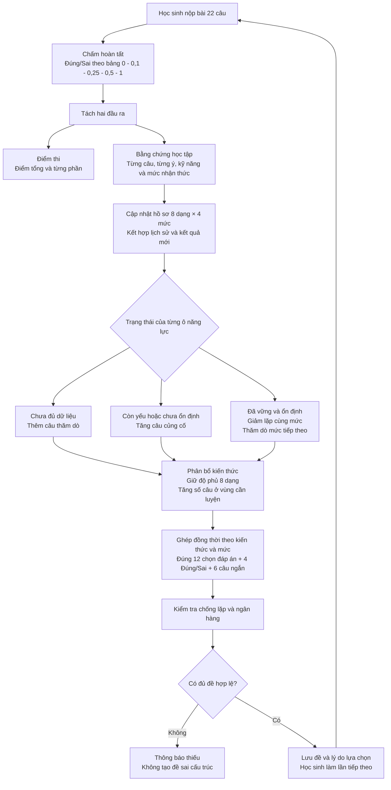
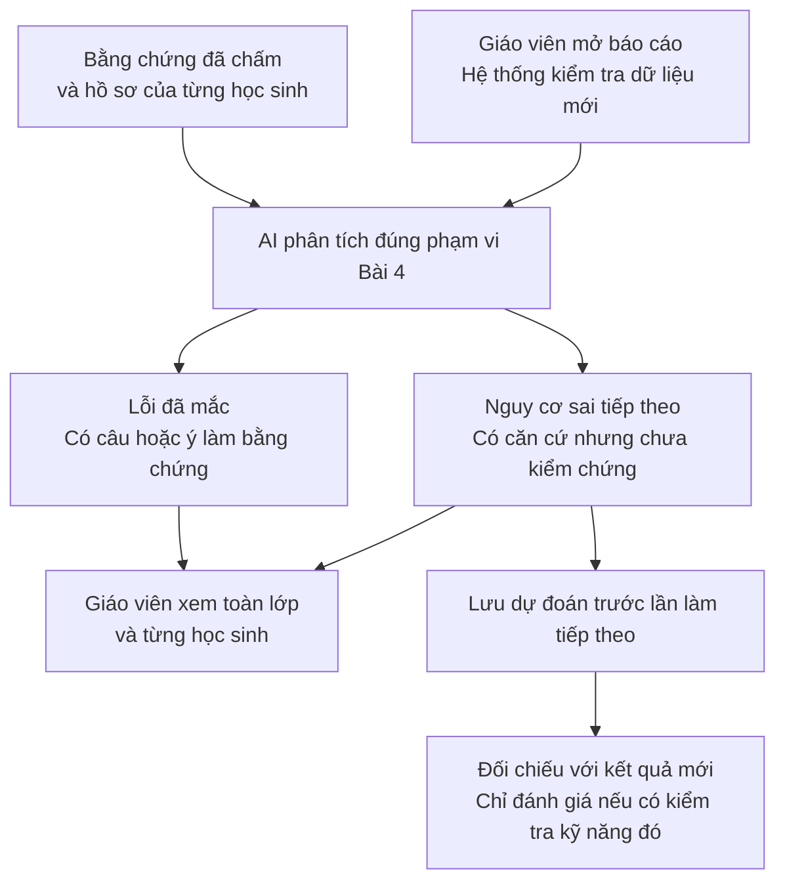

# Phân bổ kiến thức và sinh đề cá nhân hoá 22 câu

Điểm cốt lõi là: **không chỉ tăng câu khó khi học sinh đạt điểm cao, mà phải biết học sinh làm tốt kiến thức nào, ở mức nào, và kết quả đó đã ổn định chưa.**

Tôi đề xuất cơ chế dưới đây cho phiên bản 22 câu. Đây vẫn là **thiết kế để chốt trước khi triển khai**, không phải mô tả rằng code hiện tại đã làm đủ tất cả.

## 1. Đề cá nhân hoá có ba chiều khác nhau

Để dễ hiểu, mỗi câu hỏi có ba “nhãn”:

| Chiều | Trả lời câu hỏi gì? | Ví dụ |
|---|---|---|
| **Dạng kiến thức** | Học sinh đang được kiểm tra nội dung nào? | Xác định số phần tử không gian mẫu |
| **Mức nhận thức** | Nội dung đó được hỏi ở mức nào? | Nhận biết, thông hiểu, vận dụng, vận dụng cao |
| **Hình thức trả lời** | Học sinh trả lời bằng cách nào? | Chọn đáp án, Đúng/Sai, trả lời ngắn |

Ví dụ: một câu **trả lời ngắn**, thuộc **dạng gieo xúc xắc**, ở mức **thông hiểu**.

Ba chiều này không thay thế nhau. Câu trả lời ngắn không mặc nhiên là câu khó; học sinh giỏi dạng đồng xu cũng không mặc nhiên giỏi dạng xúc xắc.

**Phần cố định:** 12 câu chọn đáp án + 4 câu Đúng/Sai + 6 câu trả lời ngắn.

**Phần thay đổi theo học sinh:** số câu của từng dạng kiến thức, mức nhận thức trong từng dạng và câu cụ thể được chọn.

## 2. Tám dạng kiến thức được theo dõi thế nào?

Theo danh mục đang có trong dự án:

| Ký hiệu viết gọn | Dạng kiến thức |
|---|---|
| D1 | Viết tập hợp không gian mẫu |
| D2 | Xác định số phần tử của không gian mẫu |
| D3 | Tính xác suất trong phép thử tung đồng xu |
| D4 | Tính xác suất trong phép thử gieo xúc xắc |
| D5 | Tính xác suất trong trò chơi vòng quay số |
| D6 | Tính xác suất trong phép thử rút thẻ |
| D7 | Tính xác suất trong phép thử viết số tự nhiên |
| D8 | Tính xác suất khi chọn một đối tượng trong nhóm |

Hệ thống cần theo dõi **8 dạng × 4 mức nhận thức**, tức tối đa 32 ô năng lực.

Ví dụ hồ sơ của một học sinh:

| Dạng | Nhận biết | Thông hiểu | Vận dụng | Vận dụng cao |
|---|---|---|---|---|
| D2 — Đếm không gian mẫu | Đã vững | Cần củng cố | Chưa đủ dữ liệu | Chưa đủ dữ liệu |
| D3 — Đồng xu | Đã vững | Đã đạt | Chưa đủ dữ liệu | Chưa đủ dữ liệu |
| D4 — Xúc xắc | Đã đạt | Còn yếu | Chưa đủ dữ liệu | Chưa đủ dữ liệu |

Từ bảng này, hệ thống biết:

- Không cần tiếp tục cho nhiều câu nhận biết D2.
- Cần củng cố thông hiểu D2 và D4.
- Có thể thử một câu vận dụng D3.
- Chưa có căn cứ đưa nhiều câu vận dụng cao vào đề.

**Không có dữ liệu phải ghi “chưa biết”, không phải “yếu”.**

## 3. Đề đầu tiên phân bố tám dạng ra sao?

Khi chưa có lịch sử, chưa thể biết học sinh yếu dạng nào. Tôi đề xuất **phân bố tương đối đều để thăm dò**, thay vì cá nhân hoá bằng phỏng đoán.

Một ví dụ:

| Dạng | Số câu ban đầu |
|---|---:|
| D1 | 3 |
| D2 | 3 |
| D3 | 3 |
| D4 | 3 |
| D5 | 3 |
| D6 | 3 |
| D7 | 2 |
| D8 | 2 |
| **Tổng** | **22** |

Hai dạng nhận 2 câu không phải ít quan trọng hơn. Khi chưa có dữ liệu, vị trí này có thể luân phiên giữa các lần tạo đề, hoặc theo trọng số nội dung do giáo viên duyệt.

Đồng thời, 22 câu vẫn phải được bố trí đúng:

- 12 câu chọn đáp án.
- 4 câu Đúng/Sai.
- 6 câu trả lời ngắn.
- Đúng ma trận mức nhận thức đã thống nhất.

**Không yêu cầu mỗi dạng phải xuất hiện đủ cả ba hình thức trong một đề**, vì 22 câu không đủ để phủ hết mọi tổ hợp.

Đối với Đúng/Sai:

- Mỗi câu cha có một dạng chính để tính vào số lượng 22 câu.
- Từng ý có thể kiểm tra kỹ năng riêng và phải được gán nhãn riêng.
- Không tính một câu Đúng/Sai vào bốn suất của bảng phân bổ.

## 4. Sau khi có kết quả mới, dựa vào yếu tố nào để điều chỉnh?

Tôi đề xuất dùng năm yếu tố sau:

| Yếu tố | Ý nghĩa đối với đề tiếp theo |
|---|---|
| **Kết quả từng kỹ năng × mức** | Xác định chỗ cần củng cố hoặc có thể thử mức cao hơn |
| **Độ đủ dữ liệu** | Phân biệt kết quả ổn định với đúng/sai do một vài câu |
| **Kết quả gần đây** | Nhận biết học sinh đang tiến bộ hoặc gặp khó trở lại |
| **Sự lặp lại của kết quả thấp** | Ưu tiên kiểm tra và củng cố vùng chưa ổn định |
| **Độ phủ kiến thức** | Không bỏ quên dạng ít được kiểm tra hoặc lâu chưa ôn |

Không dùng riêng điểm tổng để quyết định.

Ví dụ: cùng được 7 điểm nhưng:

- Học sinh A yếu D2, D4.
- Học sinh B yếu D6, D7.

Hai em cần đề tiếp theo khác nhau dù điểm tổng bằng nhau.

### Kết quả mới nhất không xoá lịch sử cũ

Có thể giữ cách tính ưu tiên kết quả gần đây của APTGA:

- Phiên mới nhất: trọng số 1.
- Phiên trước đó: 0,8.
- Phiên trước nữa: 0,64.
- Tiếp tục giảm dần.

Các phiên được tính trong đúng ô kiến thức đang xét. Làm một bài về D3 không tự làm thay đổi đánh giá D4.

Quy tắc hiện tại “ít nhất 5 câu khác nhau và 2 phiên trong một ô” có thể giữ làm ngưỡng đủ dữ liệu ban đầu. Đây là **ngưỡng thiết kế thử nghiệm**, không phải bảo đảm thống kê.

Vì có nhiều ô kiến thức, một bài đầu tiên không thể đánh giá chắc chắn toàn bộ 32 ô. Hệ thống phải thể hiện trung thực điều đó.

## 5. Phân bổ số câu theo kiến thức: giữ độ phủ, tăng đúng chỗ cần luyện

Tôi đề xuất quy tắc dễ kiểm soát:

### Lớp thứ nhất: bảo đảm không bỏ quên kiến thức

Nếu cả tám dạng đều thuộc phạm vi đã học và ngân hàng đáp ứng:

- Mỗi dạng có tối thiểu **1 câu chính**.
- Dùng 8 câu để bảo đảm độ phủ.
- Còn **14 câu** để phân bổ theo nhu cầu cá nhân.

### Lớp thứ hai: phân bổ 14 câu còn lại

Ưu tiên lần lượt theo hồ sơ:

- Dạng có điểm yếu đã được xác nhận.
- Dạng có kết quả chưa ổn định.
- Dạng chưa đủ dữ liệu.
- Dạng đã vững nhưng cần ôn duy trì.

Giới hạn đề xuất: **không quá 5 câu chính cho một dạng trong một đề**, tránh đề bị dồn gần hết vào một nội dung.

Các con số tối thiểu 1 và tối đa 5 là **quy tắc mới đề xuất**, cần kiểm chứng khi triển khai.

### Ví dụ đề tiếp theo

Giả sử lịch sử đã đủ để nhận thấy D2, D4 còn yếu; D7 cần thăm dò thêm; D1, D3, D5 đã tương đối ổn định:

| Dạng | Đề trước | Đề tiếp theo | Lý do |
|---|---:|---:|---|
| D1 | 3 | 2 | Giảm luyện lặp lại, vẫn giữ ôn |
| D2 | 3 | 4 | Tăng củng cố điểm yếu |
| D3 | 3 | 2 | Đã ổn định |
| D4 | 3 | 4 | Còn yếu, cần thêm bằng chứng |
| D5 | 3 | 2 | Chuyển một suất sang vùng cần thiết hơn |
| D6 | 3 | 3 | Giữ theo nhu cầu hiện tại |
| D7 | 2 | 3 | Bổ sung thăm dò |
| D8 | 2 | 2 | Duy trì độ phủ |
| **Tổng** | **22** | **22** | |

Đây là **ví dụ phân bổ hợp lý**, không phải kết quả bắt buộc cho mọi hồ sơ tương tự.

Bộ chọn phải tìm phương án đáp ứng đồng thời số câu theo dạng kiến thức, hình thức và mức nhận thức. Nếu không khả thi, không được âm thầm phá cấu trúc 12–4–6.

## 6. Nếu học sinh làm tốt một mức rồi, đề sau thay đổi thế nào?

**Không nên chuyển ngay từ “làm đúng một lần” sang “đã thành thạo”.**

Tôi đề xuất các hành động sau:

| Tình trạng trong một dạng kiến thức, một mức | Cách điều chỉnh |
|---|---|
| Chưa đủ dữ liệu | Chọn câu mới cùng mức để kiểm tra thêm |
| Dưới 70%, đủ dữ liệu | Ưu tiên củng cố cùng mức; xem xét câu nền tảng nếu có quan hệ chuyên môn được duyệt |
| Từ 70% đến dưới 85% | Tiếp tục luyện đa dạng và có thể thêm một câu thăm dò ở mức cao hơn |
| Từ 85%, đủ dữ liệu và kết quả gần đây ổn định | Giảm câu lặp cùng mức; chuyển một phần sang thăm dò mức tiếp theo |
| Kết quả mới giảm mạnh | Kiểm tra lại bằng câu mới trước khi kết luận năng lực giảm |

Để tránh tăng khó quá nhanh, có thể yêu cầu khi đánh dấu “sẵn sàng thử mức cao hơn”:

- Đủ số câu và số phiên.
- Ước lượng năng lực từ 85% trở lên.
- Hai phiên gần nhất ở ô đó đều đạt ít nhất 80%.

Đây là **điều kiện đề xuất để thử nghiệm**, không phải thang đo đã được chuẩn hoá.

### Ví dụ cụ thể với D4 — Gieo xúc xắc

Giả sử D4 được phân bổ 4 câu:

| Mức nhận thức của D4 | Khi thông hiểu còn yếu | Khi thông hiểu đã vững |
|---|---:|---:|
| Nhận biết | 1 | 1 |
| Thông hiểu | 3 | 2 |
| Vận dụng | 0 | 1 |
| Vận dụng cao | 0 | 0 |
| **Tổng** | **4** | **4** |

Ý nghĩa:

- Không nhất thiết giảm ngay tổng số câu D4.
- Thay một câu thông hiểu bằng một câu vận dụng mới để thăm dò.
- Nếu câu vận dụng sai, chỉ cập nhật khó khăn ở vận dụng; không xoá kết luận đã vững thông hiểu.
- Nếu tiếp tục làm tốt vận dụng qua đủ bằng chứng, mới tăng dần cơ hội luyện mức đó.
- Không nhảy thẳng lên vận dụng cao chỉ vì thông hiểu đã tốt.

Việc tăng mức này là **thăm dò trong cùng dạng**, không khẳng định bốn mức luôn là một chuỗi kiến thức tiên quyết. Chọn câu chuyển tiếp vẫn cần dựa vào phân loại và chuyên môn của giáo viên.

Toàn đề tiếp tục giữ giới hạn điều chỉnh mức nhận thức đã đề xuất: tối đa 4 câu, có sàn/trần. Ví dụ cục bộ trên chỉ áp dụng khi tổng thể đề vẫn hợp lệ.

## 7. Chấm Đúng/Sai đúng bảng bạn gửi

Chốt theo yêu cầu của bạn: **mỗi câu Đúng/Sai có tối đa 1 điểm**, tính như sau:

| Số ý chọn chính xác | Điểm cả câu |
|---:|---:|
| 0 | 0 |
| 1 | 0,1 |
| 2 | 0,25 |
| 3 | 0,5 |
| 4 | 1,0 |

Bốn câu Đúng/Sai có tối đa **4 điểm**. Không chấm mỗi ý đúng bằng 0,25 điểm rồi cộng lại.

### Nhưng điểm câu và bằng chứng năng lực phải tách nhau

Ví dụ học sinh trả lời đủ bốn ý:

| Ý | Kỹ năng được kiểm tra | Kết quả |
|---|---|---|
| a | Xác định các kết quả có thể xảy ra | Đúng |
| b | Đếm số phần tử không gian mẫu | Đúng |
| c | Đếm kết quả thuận lợi | Sai |
| d | Xác định xác suất | Đúng |

Hệ thống ghi:

- **Điểm câu: 0,5 điểm**, vì đúng 3 ý.
- **Bằng chứng: đúng a, b, d; sai c.**
- Lần luyện sau cần kiểm tra thêm kỹ năng ở ý c, không kết luận toàn bộ nội dung của câu đều yếu.

Đặc biệt, không lấy `0,5/1 điểm` rồi mặc nhiên kết luận “học sinh hiểu được 50% mọi kỹ năng trong câu”.

Quy tắc bổ sung:

- Ý bỏ trống không được tính là đúng, nhưng phải ghi riêng “bỏ trống”, không gọi là sai lầm nhận thức đã xác nhận.
- Bốn ý cùng câu không được làm độ đủ dữ liệu tăng như bốn câu độc lập.
- Với câu gồm nhiều kỹ năng, bằng chứng được phân bổ theo nhãn từng ý, không sao chép cùng kết quả sang tất cả kỹ năng.
- Nhãn kỹ năng từng ý phải có cơ sở; chưa có thì không tự suy đoán.

Đây là phần thay đổi quan trọng so với cách dùng điểm chuẩn hoá của cả câu trong hồ sơ hiện tại.

## 8. Kết quả mới nhất được xử lý theo thứ tự nào?

Sau mỗi bài đã chấm hoàn tất:

1. **Lưu đáp án thực tế:** từng câu, từng ý Đúng/Sai.
2. **Tính điểm thi:** giữ đúng thang điểm đã chốt.
3. **Tách bằng chứng học tập:** đúng, sai, bỏ trống; kỹ năng và mức liên quan.
4. **Cập nhật đúng ô năng lực:** không thay đổi những ô chưa được kiểm tra.
5. **Đối chiếu lịch sử:** đánh giá tiến bộ, ổn định hay cần kiểm tra thêm.
6. **Lập nhu cầu đề tiếp theo:** tăng củng cố, thêm thăm dò hoặc giảm câu lặp.
7. **Ghép đúng 22 câu:** đồng thời giữ cấu trúc 12–4–6 và chống lặp.
8. **Lưu lý do lựa chọn:** để giáo viên biết vì sao học sinh được giao những câu đó.

Nói ngắn gọn: **kết quả mới thay đổi nhu cầu luyện tập; nhu cầu luyện tập quyết định nội dung đề tiếp theo.**

## 9. AI sẽ báo gì cho giáo viên?

AI đọc cùng bộ bằng chứng nhưng phục vụ mục đích khác với bộ sinh đề.

Ví dụ sau bài mới:

**Lỗi đã mắc**

> “Học sinh trả lời sai các ý yêu cầu đếm kết quả thuận lợi trong hai phiên gần đây.”

Phải dẫn tới đúng câu, ý và lần làm.

**Nguy cơ sai tiếp theo**

> “Học sinh có thể tiếp tục bỏ sót kết quả thuận lợi khi giải câu trả lời ngắn về xúc xắc. Cần kiểm tra bằng câu mới cùng kỹ năng.”

Đây là giả thuyết, không phải sự thật đã xảy ra.

Báo cáo lớp tổng hợp số học sinh có bằng chứng liên quan, nhóm cần hỗ trợ và nhóm chưa đủ dữ liệu. Không gọi tất cả học sinh chưa làm dạng đó là “không có nguy cơ”.

**Đề xuất giai đoạn đầu:** thuật toán sinh đề dùng bằng chứng đã chấm; dự đoán AI chỉ hỗ trợ giáo viên. Chưa đưa dự đoán chưa kiểm chứng trở lại bộ chọn câu, để tránh một nhận định AI sai liên tục điều khiển việc học.

## 10. Sơ đồ hoạt động

### A. Từ kết quả mới đến đề cá nhân hoá tiếp theo

### B. Nhánh dự đoán sai lầm cho giáo viên

**Tóm lại:** giữ nguyên hình thức đề 22 câu, phân bổ kiến thức theo nhu cầu, tăng độ khó từng bước khi có bằng chứng ổn định, và dùng kết quả từng ý để hiểu học sinh — không dùng riêng điểm tổng để quyết định mọi thứ.
